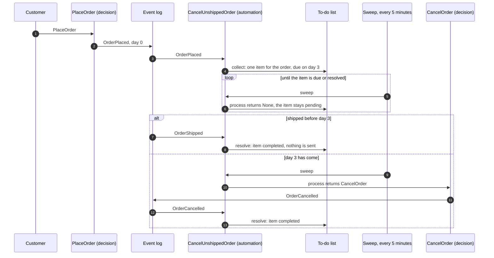
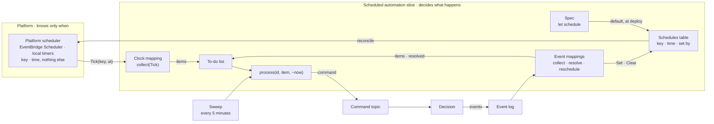
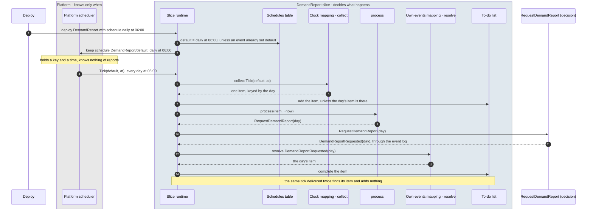
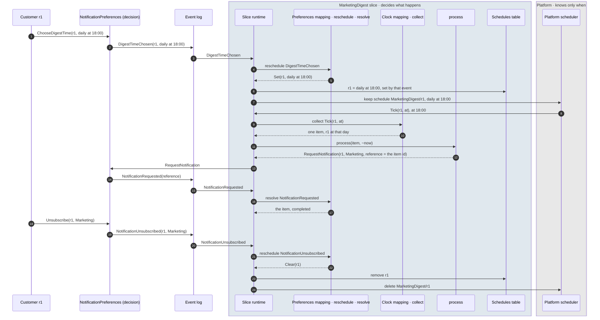
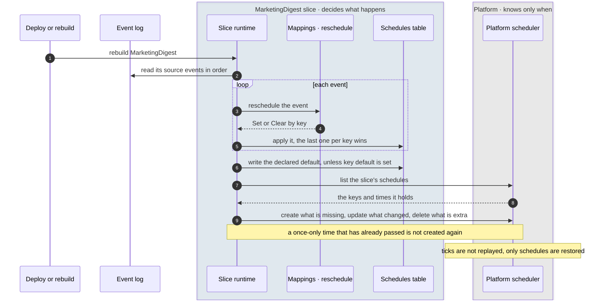
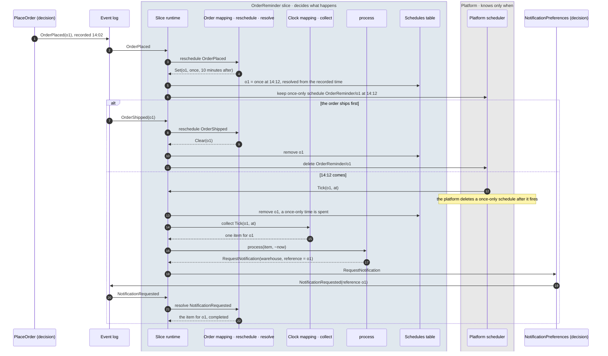
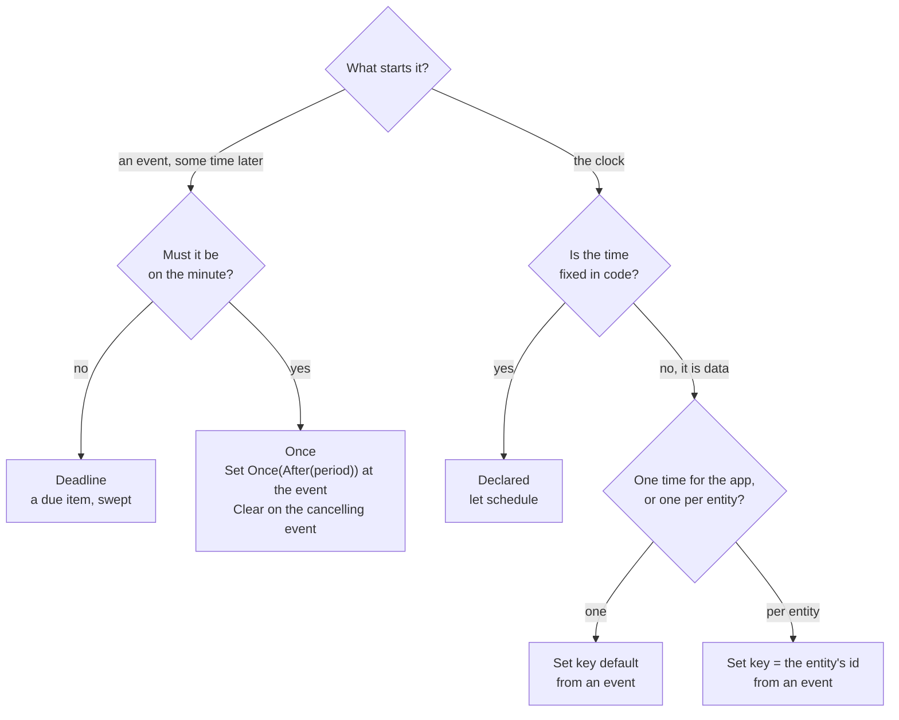

# Automations that run on a time

**Status:** Analysis. Its decisions and [T1](#9-open-questions) to [T11](#9-open-questions) were
agreed on 2026-10-15 ([T10](#9-open-questions) as version B); carried out by
[the plan](../plans/automations-that-run-on-a-time.md).
**Date:** 2026-10-15
**Subject:** Work an application does because a time has come rather than because an event
arrived: a deadline after an event (*cancel an order not shipped three days after it was
placed*), a recurring time declared in code (*a demand report every morning at 06:00*), and a
recurring time set while the application runs by an event that carries it (*a marketing digest
at the time each customer chooses*), and how the
[AutomationSlice](../../packages/doc/docs-app/components/automationslice.md) can carry all three.
Examples are from the online shop ([§8](#8-examples-from-the-online-shop)).
**Question:** Can an automation run on a time today? If not, should time get a slice of its own,
or should the AutomationSlice learn to be started by a schedule, declared or set by events, and
what would that take in the spec, the builders, both platforms and the GWT DSL?

---

## Summary

1. *Can an automation run on a time today?* **A deadline, roughly; a recurring time, no.** A
   deadline can be written as an automation whose `process` waits until the due time, picked up
   by the sweep every five minutes on AWS ([§3](#3-deadlines-today)). A recurring time cannot:
   schedules are only created at run time, by a Task, an extension point's directive handler or
   a SideEffectHandler, and what fires is a payload on a queue, not an automation
   ([§2](#2-what-exists-today)).
2. *A slice of its own, or the AutomationSlice?* **The AutomationSlice, with a schedule declared on
   its spec** ([§4](#4-three-ways-to-run-on-a-recurring-time)). A slice that only "fires a command
   on a time" would have to rebuild what the automation already gives: one command per item even
   when a tick is delivered twice, retries, `onExhausted`, a to-do list that can be queried. And
   most recurring work is about state the automation already collects (*the sessions still open
   at 02:00*).
3. *What does the tick look like?* **A framework-defined source event, `Tick({at})`, read by
   `collect` through a mapping like any other source** ([§5.2](#52-the-tick-is-a-source)), so
   `resolve` and `process` are unchanged and the item id makes each tick idempotent.
4. *What else is needed?* **The time where the functions decide**: the recorded time of the
   source event for `collect`, and `now` for `process` ([§6](#6-the-time-inside-the-functions)).
   Without them deadlines read the wall clock and cannot be tested at a fixed time.
5. *What has to be fixed first?* **The two schedulers' reading of a schedule's time** (`Schedule.rate` today), which
   disagree for every wall-clock time, and the AWS `Daily` expression
   ([the scheduler analysis §3.3](infrastructure-outside-the-capability-model.md#33-the-two-implementations-do-not-agree-about-the-vocabulary),
   [§3.4](infrastructure-outside-the-capability-model.md#34-a-latent-defect-in-the-aws-arm)).
   A declared schedule that fires at 02:00 on AWS and 24 hours after boot locally would teach
   the wrong thing in development ([§7](#7-order-of-work)).
6. *Can an event set or change a schedule?* **Yes, and it should: the same automation, with a
   `reschedule` function on its mappings that turns an event into *set this schedule* or *clear
   it*, keyed so one slice can hold one schedule or one per customer**
   ([§5.6](#56-schedules-set-by-events)). A declared `schedule` is then only the default under the
   key `default`, and an event can replace it. The runtime keeps the current schedules in the
   slice's query store, so they survive a redeploy and can be read.
7. *What does AWS need for that?* **EventBridge Scheduler instead of classic rules**: a schedule
   per customer needs far more than the few hundred rules a bus allows, and Scheduler also gives
   time zones ([§5.6](#56-schedules-set-by-events), [T1](#9-open-questions)).
8. *Do a calendar time, an interval and a single moment need different approaches?* **The same
   mechanism, three answers to *when next*.** A calendar time needs a zone and a wall-clock
   calculation, an interval only the previous firing, a single moment clears itself after it
   fires, and one relative to an event (*ten minutes after*) is resolved from the event's recorded
   time so a replay gives the same moment. `Schedule.rate` becomes `Schedule.time`, with one
   constructor per shape: `Every`, `Calendar` and `Once`
   ([§5.7](#57-three-shapes-of-a-time)). Diagrams of each flow are in [§3](#3-deadlines-today),
   [§5](#5-the-design-of-a), [§5.3](#53-the-schedule-is-made-at-deploy-time),
   [§5.6](#56-schedules-set-by-events) and [§5.7](#57-three-shapes-of-a-time).

---

## Words

Three words name the timing, one per level, and are not synonyms: **the platform's Scheduler
fires; the slice's schedule says when; the Clock is how the firing reaches the slice.** Merging
them would hide where each lives, as an event log and a source module are kept apart.

| Word | Names | Level |
|---|---|---|
| **Scheduler** | the infrastructure that fires at a time: EventBridge Scheduler on AWS, timers locally (`ComponentType.Scheduler`) | platform |
| **schedule** | one key and one time held by one slice: the declared default (`let schedule`), a row in its query store, an entry on the platform | slice |
| **time** | when a schedule fires: `Every` an interval, `Calendar` a wall-clock time, or `Once` a single moment (`Schedule.time`, which replaces today's `Schedule.rate`, [T10](#9-open-questions)) | value |
| **Clock**, **Tick** | the framework source a slice maps, and its one event `Tick({key, at})` | slice input |
| **`reschedule`** | the mapping function that sets or clears schedules. *Re-* because, from the slice's side, every `Set` or `Clear` changes its schedules, the first one too | slice code |
| **sweep** | the run over pending to-do items every five minutes, on AWS one for all automations; for a scheduled slice it retries, it does not time ([§5.2](#52-the-tick-is-a-source)) | runtime |
| **heartbeat** | the plugin's liveness signal; not the sweep, though an automation's `heartbeatInterval` is named after it ([T6](#9-open-questions)) | runtime |
| **to-do list**, **schedules** | the two kinds of row in the slice's one query store ([§5.8](#58-keys-and-rows-in-the-query-store-and-the-platforms-names)) | storage |

The same definitions belong in the [terminology guide](../guides/terminology-guide.md) when the
work is planned.

## 1. Three kinds of time

| Kind | Examples | What starts it | What ends it |
|---|---|---|---|
| **A deadline** after an event | cancel an order not shipped three days after it was placed; expire an email challenge after a day | the event, plus a duration | the due time passing, or a cancelling event first (*the order was shipped*) |
| **A recurring time, declared** | a product demand report every morning at 06:00; settle every 15 minutes | the clock, at a time written in the spec | each run's own work |
| **A recurring time, set by an event** | the catalog team moves the demand report to 07:30; each customer picks when their marketing digest comes | the clock, at a time an event carried; changed or cleared by later events | each run's own work, until an event clears the schedule |

All three are the Event Modeling automation pattern with time as one of its inputs. A deadline is
an item on the to-do list that is not yet due; a recurring time is a tick that makes items. The
third differs from the second only in where the time comes from: a declared time is part of the
code and changes with a deploy, a time set by an event is part of the application's data and
changes when someone changes it.

## 2. What exists today

| Piece | Where | What it does with time |
|---|---|---|
| **AutomationSlice** | [AutomationSlice.res](../../reventless/spec/src/components/AutomationSlice.res) (spec), [component guide](../../packages/doc/docs-app/components/automationslice.md) | `collect(sourceEvent, ~sourceId, context)` makes to-do items; `resolve(sourceEvent)` closes one; `process(id, item)` returns a command or `None`, and an item left pending is tried again on the next sweep. None of the three is given a time |
| **The sweep** (AWS) | `makeSweepSchedule` in [AutomationSliceRuntime_Builder_Single.res](../../reventless/aws/src/adapter/Runtime/AutomationSliceRuntime_Builder_Single.res) | one EventBridge rule, `AllAutomationSlicesSweep`, invokes the shared automation Lambda every five minutes with no records; each slice works its backlog (`sweep` in [AutomationSliceEntryPoint_Ops.res](../../reventless/aws/src/adapter/Runtime/AutomationSliceEntryPoint_Ops.res)). A slice's own `heartbeatInterval` does not change it |
| **The sweep** (local) | [AutomationSlice_Builder.res](../../reventless/local/src/components/AutomationSlice_Builder.res) | none found: locally a pending item moves only when the next event arrives. To confirm |
| **`Schedule.rate`** | [Schedule.res](../../reventless/spec/src/types/Schedule.res) | `Single`, `Minutes`, `Hours`, `Days`, `Daily`, `Weekdays`, `WeekdaysAndSaturday`; a schedule is `{name, rate, payload}` |
| **The scheduler** | [Scheduler_Adapter.res](../../reventless/core/src/components/Scheduler/Scheduler_Adapter.res); AWS [ScheduledPublisher_CloudWatchEvents_Runtime.res](../../reventless/aws/src/adapter/ScheduledPublisher/ScheduledPublisher_CloudWatchEvents_Runtime.res), local [LocalScheduledPublisher.res](../../reventless/local/src/adapter/Scheduler/LocalScheduledPublisher.res) | `createSchedule` / `deleteSchedule` at run time, reached by a Task (`CreateSchedule` action), an extension point's directive handler and a SideEffectHandler; the payload is delivered to a queue. No spec declares a schedule ([the scheduler analysis §1](infrastructure-outside-the-capability-model.md#1-the-worked-case-what-the-scheduler-is-today)) |
| **The plugin heartbeat** | [Heartbeat_Builder.res](../../reventless/core/src/components/Heartbeat/Heartbeat_Builder.res) | a fixed-interval runner per plugin for liveness; unrelated to application work |
| **GWT for automations** | [Automation_GWT.res](../../reventless/gwt/src/Automation_GWT.res) | `whenCollect`, `whenResolve`, `givenTodo`/`whenProcess`, `givenEvents`/`whenSweep`; no step sets a time |

So the framework already has a clock (the scheduler) and a loop that retries pending work (the
sweep), but no way to say *this automation runs at 02:00*, and no time inside the functions that
decide.

## 3. Deadlines today

A deadline can be written now:

```rescript
// todoItem carries the due time, from a time in the event's payload
let collect = (event, ~sourceId as _, _ctx) =>
  switch event {
  | OrderPlaced({orderId, placedAt}) => [(orderId, {orderId, dueAt: placedAt +. threeDays})]
  | _ => []
  }
let resolve = event =>
  switch event {
  | OrderShipped({orderId}) | OrderCancelled({orderId}) => Some(orderId)
  | _ => None
  }
let process = (id, item) =>
  Date.now() >= item.dueAt ? Some((id, CancelOrder({orderId: item.orderId}))) : None
```

It works because an item for which `process` returns `None` stays pending and is tried again by
the sweep, and a shipped order is resolved before it is due:



Four limits:

1. **Precision is the sweep's**: five minutes on AWS, for every slice. Fine for hours and days,
   wrong for seconds.
2. **`collect` cannot read when the event happened.** The due time has to come from a field of
   the event's payload (`placedAt`, which the shop's `OrderPlaced` does not have today); the
   event's recorded time is in its metadata, which `collect` is not given
   ([§6](#6-the-time-inside-the-functions)).
3. **`process` reads the wall clock.** A GWT scenario cannot say *three days later*; it can only
   run at whatever time the test runs.
4. **Locally nothing sweeps** ([§2](#2-what-exists-today)), so a deadline passes in development
   only when another event reaches the slice.

## 4. Three ways to run on a recurring time

| | A. A schedule on the AutomationSlice | B. A scheduled slice of its own | C. A Task that creates a schedule |
|---|---|---|---|
| What the developer writes | `let schedule` on the spec; `collect` reads `Tick` | a time, a target and a command | a Task whose `setup` returns `CreateSchedule`, and code that publishes commands when the payload arrives |
| One command per tick when a tick is delivered twice | yes: the item id (the tick's time) deduplicates | to be built | to be built |
| Retries, `onExhausted`, a queryable to-do list | yes, as now | to be built | no |
| Can work on collected state (*the sessions still open*) | yes: the tick processes items `collect` gathered from events | no, or a read of a view at fire time | by querying, by hand |
| New in the framework | a spec field, a source, a deploy-time rule per schedule, a GWT step | a component type, builder, both platforms' runtimes, PPX, GWT DSL, docs | nothing |
| Visible in the plugin's structure | yes, as an automation with a schedule | yes, as a new kind | no: schedules are made at run time |

**Recommendation: A.** B duplicates the automation and still lacks state; C works today but hides
the work inside imperative code that nothing can read, test with the DSL, or show. A adds the
least and makes a scheduled automation a normal automation.

## 5. The design of A

**No new component type and no new spec type.** A *scheduled automation* is an ordinary
`AutomationSlice`: the same `Automation/` folder, the same generated
`Platform.AutomationSlice.Make(Spec, Automation)`. What is added is optional and defaulted by the
PPX, so every existing automation compiles unchanged:

| What | Added |
|---|---|
| The spec (`<Name>.res`) | `let schedule`, `None` by default ([§5.1](#51-the-spec)) |
| The mappings (`<Name>_Automation.res`) | `reschedule`, *none* by default ([§5.6](#56-schedules-set-by-events)) |
| The framework | the `Clock` source and its `Tick` event, read by a mapping like any source; a source, not a component ([§5.2](#52-the-tick-is-a-source)) |
| The query store | schedule rows in the existing `<Name>Todo` store ([§5.8](#58-keys-and-rows-in-the-query-store-and-the-platforms-names)) |
| Infrastructure | only for a slice with a `schedule` or a `reschedule`: its schedules on the platform scheduler, and the scheduler's operations in its runtime |
| PPX | no new annotation: `@@reventless.spec` and `@@reventless.automation` inject the defaults and record the schedule ([§5.4](#54-what-the-plugin-structure-records)) |

*Scheduled* is a description the build can read (a declared `schedule`, or a mapping with
`reschedule`), not a kind.

The parts, and how a time reaches the decision. **The platform knows only when; the slice
decides what.** The platform scheduler holds a key and a time per schedule and, when the time
comes, sends `Tick(key, at)` to the slice. That is all it ever sends, the same for every slice.
What a tick means (which item it makes, which command is sent, what completes it) is written in
the slice's mappings and `process`, exactly as for an event. New here are the clock source, the
`reschedule` function and the schedules table; the rest exists today:



### 5.1 The spec

```rescript
// <Name>.res, beside maxRetries and heartbeatInterval
let schedule: option<Schedule.time> = Some(Calendar({calendar: Daily({hour: 2, minute: 0})}))
```

`None` is today's automation, or one whose schedules all come from events
([§5.6](#56-schedules-set-by-events)). A declared schedule is held under the key `default`, so
an event can replace it without a redeploy ([T3](#9-open-questions)).

### 5.2 The tick is a source

The framework supplies a source whose only event is `Tick({key: string, at: float})`: which of
the slice's schedules fired (`default` for the declared one), and when. It has the shape of the
source modules an automation already declares for a DCB log (`OrderingDcbSource` in the
[component guide](../../packages/doc/docs-app/components/automationslice.md#complete-example-ship-order-automation)),
but lives in the framework and is never written by an application:

```rescript
// reventless/spec/src/components/Clock.res (new), reached as Reventless.Clock
let name = "Clock"

@schema
type event = Tick({key: string, at: float}) // `at`: the scheduled time, not the delivery time

// The to-do item id for a tick: `<key>@<scheduled time in UTC, to the minute>`
let itemId: (string, float) => string
```

A slice maps it like any other source, with `Mapping.Make`, so a slice can be started by events,
by its schedules, or by both:

```rescript
module FromClock = Mapping.Make(
  Reventless.Clock,
  DemandReport,
  {
    open Reventless.Clock
    let collect = (Tick({key, at}), ~sourceId as _, _ctx) =>
      [(itemId(key, at), ({day: at}: DemandReport.todoItem))]
    let resolve = _ => None // a tick never completes anything
  },
)
```

The complete files of each example are in [§8](#8-examples-from-the-online-shop).

- **Idempotent per tick:** the item id is the tick's time (and key, where there are several), so
  a tick delivered twice adds one item.
- **Working on collected state:** a slice that gathers open orders from events can let the tick
  decide only *when* `process` sends; [T2](#9-open-questions) asks how a tick reaches items that
  are already pending.
- **The sweep is unchanged, and still needed.** It does not decide when a scheduled slice works;
  the ticks do. But two of its three jobs hold for a tick's item as for any other: retrying an
  item whose command could not be published, and sending again one stuck in *Processing* because
  no resolving event came back. Without it a failed morning report would wait a day for the next
  tick. Its third job, re-running items `process` left pending, matters only for deadlines, and a
  once-only schedule can take a precise deadline off it ([§5.7](#57-three-shapes-of-a-time)). It
  costs nothing extra: on AWS it is one rule for all automations. The platform's own retry of a
  failed tick delivery helps (the item id is the scheduled time, so a retried tick is
  harmless) but covers only a run that fails as a whole, not a command sent and never answered.
- **A tick never resolves anything, but its item must be resolved.** The clock mapping's
  `resolve` is always `None`; the item a tick makes is completed by the event its command
  produces, read by `resolve` on the mapping of that event's source. So the command carries the
  item's id (the day, or a `reference`) and the event carries it back. Without that the item
  stays *Processing*, and the sweep, which picks up items stuck in *Processing* beyond a timeout
  (the component guide calls it the
  [heartbeat handler](../../packages/doc/docs-app/components/automationslice.md#heartbeat-handler)),
  sends the command again.

### 5.3 The schedule is made at deploy time

Each slice with a `schedule` gets its own scheduled rule at deploy time, in the same shape as
`makeSweepSchedule`: on AWS an EventBridge rule targeting the shared automation Lambda with a
payload that names the slice; locally a timer in the local platform. It is not made through
`createSchedule` at run time, so it is declared, visible in the plugin's structure, removed with
the slice, and needs no runtime permission to create rules.

Both platforms must read a schedule's time the same way first: every wall-clock time differs today, and
`Daily` is malformed on AWS
([the scheduler analysis §3.3](infrastructure-outside-the-capability-model.md#33-the-two-implementations-do-not-agree-about-the-vocabulary),
[§3.4](infrastructure-outside-the-capability-model.md#34-a-latent-defect-in-the-aws-arm)). One
shared function that computes the next firing from a `Schedule.time`, used by the local timer and
tested against the AWS expression, would make them agree.

A declared schedule, from deploy to the decision (the demand report of
[§8.2](#82-a-declared-schedule-the-demand-report-every-morning)):



### 5.4 What the plugin structure records

The slice's `schedule` goes into its sidecar and the plugin's structure with the slice's other
spec fields, so whatever reads a plugin's structure (the documentation site, the admin views, a
diagram) can say *runs daily at 02:00*.

**No new PPX annotation.** The two an automation already has do the work, each with a few more
duties ([reventless-ppx](../../packages/reventless-ppx)):

| Annotation | Today | Added |
|---|---|---|
| `@@reventless.spec` on `<Name>.res` | injects `name`, `moduleUrl`, the id and DCB tags; writes `<Name>.model.json` | injects `let schedule = None` when the spec has none; writes the declared time into `.model.json` |
| `@@reventless.automation` on `<Name>_Automation.res` | injects the `Mappings.Make` wrapper and the source's DCB tags; writes `<Name>_Automation.wiring.json` with each mapping and its source | injects `let reschedule = _ => []` into a mapping that has none; marks in `.wiring.json` which mappings reschedule and which read the `Clock` source; supplies `~now` to a `process` that does not take it ([T4](#9-open-questions)) |

One check fits there too: a mapping that reads `Clock` in a slice with no declared `schedule` and
no mapping that reschedules would never receive a tick, and the PPX can say so at build time
rather than leaving a silent automation.

### 5.5 Testing

`Automation_GWT` gains a step that delivers a tick (`whenTick(at)`, through the same collect,
resolve and process path as `whenSweep`) and, with [§6](#6-the-time-inside-the-functions), a way
to fix the time a scenario runs at (`atTime(t)`), so a deadline is tested as *given an order
placed, at three days later, then CancelOrder*. With [§5.6](#56-schedules-set-by-events), a
`whenCollect` scenario also checks the schedules an event sets or clears (`thenSchedules`).

### 5.6 Schedules set by events

A declared schedule changes only with a deploy. Often the time is data: a team moves its report,
a customer picks the hour of a digest. The same automation can take its schedules from events.

**The mapping says which schedules an event sets.** Beside `collect` and `resolve`, a mapping
may have `reschedule`, which the PPX defaults to *none*:

```rescript
type scheduleChange =
  | Set({key: string, time: Schedule.time})
  | Clear({key: string})

let reschedule: sourceEvent => array<scheduleChange>
```

- **The key** names one of the slice's schedules: `default` for a slice-wide time (and the
  declared one, which an event may then replace), or an id (`recipientId`) for a time per entity.
  The tick carries it back, so `collect` knows whose time came.
- **Set is idempotent and the last one wins**: setting the same key again replaces its time;
  clearing a key that has no schedule does nothing.
- **The time travels in the event** as a `Schedule.time`, a `@schema` type the
  event can carry, so the decision that records *the digest time was chosen* writes the time the
  automation then reads.

**The runtime keeps the current schedules.** Each set or clear is written to a schedules table in
the slice's query store, beside its to-do list, before the platform scheduler is told. The table
is the truth; the platform's schedules follow it.

- **Two tables, one store.** Every automation already has its to-do list, kept in the query store
  its builder creates. A scheduled one keeps its schedules **in that same query store**, as a
  second kind of record (`key`, `time`, and the event that set it or *declared*). **No separate
  table resource is created**: no second query store, no extra table on AWS or locally. One query
  API then answers both *what is pending* and *when does it run*.
- **Only for a scheduled slice.** The table exists when the slice declares `schedule` or a
  mapping has `reschedule`; the PPX knows the second, the plugin's structure records the first.
  A plain automation has the to-do list only, as today.
- **Why not trust the platform's schedules:** local timers vanish on restart, and the platform
  cannot be rebuilt from the event log; the table can, which is what replay and reconciliation
  below rely on.

- **Redeploy and replay:** the table is rebuilt in event order like the to-do list, so the last
  event for a key wins, and the platform's schedules are reconciled with the table, creating what
  is missing and deleting what is not in it.
- **Observability:** the table answers *when does this run, and who set it* through the same
  query API as the to-do list.
- **The declared default** is written to the table at deploy under `default` unless an event has
  already set that key.

A schedule set and cleared by events (the marketing digest of
[§8.4](#84-a-schedule-per-customer-the-marketing-digest)):



Rebuilding the table and bringing the platform in line, after a redeploy or a replay:



**The scheduler is given to the automation.** Today the scheduler's operations reach a Task, an
extension point and a SideEffectHandler, not an automation
([the scheduler analysis §1](infrastructure-outside-the-capability-model.md#1-the-worked-case-what-the-scheduler-is-today));
the automation's runtime needs them too, and the deploy-time rule of
[§5.3](#53-the-schedule-is-made-at-deploy-time) becomes one more `Set` the runtime applies.

**On AWS this wants EventBridge Scheduler, not classic rules.** Classic rules are limited to a
few hundred per event bus by default, so one schedule per customer would hit the limit; EventBridge
Scheduler holds up to ten million schedules per account and region by default, takes a time zone
per schedule ([T1](#9-open-questions)), and can fire once at a time, which also suits a deadline
with a precise time. The quotas are the documented defaults and want confirming for the account
used. Locally the timer keeps one handle per key.

**When not to use a schedule per entity.** A time per customer that only needs the sweep's
precision can also be a due time on a to-do item, renewed by the event that the run itself
records (*digest sent* collects the next digest's item). That needs no platform schedule at all
([T8](#9-open-questions)).

### 5.7 Three shapes of a time

A time can be a calendar time (*every day at 06:00*, *the first of every month*), an interval
(*every five minutes*), or a single moment (*at 23:59 on 31 December*, *ten minutes from now*).
`Schedule.rate` already mixes all three, as one flat list
([Schedule.res](../../reventless/spec/src/types/Schedule.res)). They go through the same
mechanism, a key in the schedules table and a `Tick` into the automation, but differ in four
things the runtime has to get right:

| | Calendar | Interval | Once |
|---|---|---|---|
| **Examples** | every day at 06:00; weekdays at 07:30; every Monday; the 1st of the month | every 5 minutes; every 2 hours | at 2026-12-31 23:59; ten minutes after an order is placed |
| **In `Schedule.rate` today** | `Daily`, `Weekdays`, `WeekdaysAndSaturday` | `Minutes`, `Hours`, `Days` | `Single(y, m, d, h, min)`, absolute, UTC |
| **Missing** | a weekday set, a day of the month, a day of the year, a time zone | weeks | a zone, a time relative to an event |
| **In `Schedule.time`** ([T10](#9-open-questions)) | `Calendar({calendar: Daily · Weekly · Monthly · Yearly, zone?})` | `Every(Minutes · Hours · Days · Weeks)` | `Once({moment: At(localTime) · After(period), zone?})` |
| **The next firing** | from the wall clock, in a zone: daylight saving shifts it, the 31st does not exist in every month | from the previous firing, no zone | one moment |
| **AWS** (EventBridge Scheduler) | `cron(...)` with a time zone | `rate(n unit)` | `at(...)`, deleted after it fires |
| **Local** | a shared `nextFiring(time, ~after)` and a timer to it, again after each firing; not a 24-hour interval as today | an interval timer, as today | one timer |
| **After it fires** | stays | stays | gone: the runtime clears the key in the table |
| **On replay** | stays as set | stays as set | made again only if its moment is still ahead |

**So the shapes need no different machinery, but three different answers to *when next*.** The
shared `nextFiring` function is what makes the local timers agree with AWS
([§5.3](#53-the-schedule-is-made-at-deploy-time)); it has to know calendars and zones for the
first shape and nothing for the other two.

**A relative once (*ten minutes from now*) is resolved when it is set, from the event's recorded
time**, not from the moment the runtime applies it: `Set({key, time: Once({moment: After(Minutes(10))})})`
on an event recorded at 14:02 becomes `Once({moment: At({…, hour: 14, minute: 12})})` in the table. A replay then produces the same
moment, and one that has passed is not made again. This needs the event's time inside the
function ([§6](#6-the-time-inside-the-functions)).

**Once, or a deadline?** Both mean *once, some time after an event*: here, *remind the warehouse
ten minutes after an order is placed, unless it has shipped* (`OrderReminder` is *new*). A deadline is a due item on
the to-do list, swept every five minutes, needing no platform schedule ([§3](#3-deadlines-today));
a once schedule fires on the minute and costs one platform schedule per item, set at the event
and cleared by the event that cancels it:



`OrderReminder_Automation.res` (*new*, `ordering/src/Order/Automation/`); its spec declares no
`schedule`, a `todoItem` of `{orderId}` and `RequestNotification` as its command:

```rescript
@@reventless.automation

module OrderingDcbSource = {
  let name = "OrderingDcbEventLog"
  @schema
  type event =
    | OrderPlaced({orderId: OrderId.t})
    | OrderShipped({orderId: OrderId.t})
    | NotificationRequested({recipientId: string, reference: string})
}

module FromClock = Mapping.Make(
  Reventless.Clock,
  OrderReminder,
  {
    open Reventless.Clock
    // the key is the order; a once-only time fires one tick
    let collect = (Tick({key, at}), ~sourceId as _, _ctx) =>
      [(itemId(key, at), ({orderId: key}: OrderReminder.todoItem))]
    let resolve = _ => None
  },
)

module FromOrderingDcb = Mapping.Make(
  OrderingDcbSource,
  OrderReminder,
  {
    open OrderingDcbSource
    let collect = (_, ~sourceId as _, _ctx) => []
    let resolve = event =>
      switch event {
      | NotificationRequested({reference}) => Some(reference)
      | _ => None
      }
    // After is resolved from the event's recorded time when the runtime applies it
    let reschedule = event =>
      switch event {
      | OrderPlaced({orderId}) => [Set({key: orderId, time: Once({moment: After(Minutes(10))})})]
      | OrderShipped({orderId}) => [Clear({key: orderId})]
      | NotificationRequested(_) => []
      }
  },
)

let mappings: array<module(Mapping)> = [module(FromClock), module(FromOrderingDcb)]

let process = (id, item: OrderReminder.todoItem) =>
  Some(("warehouse", RequestNotification({recipientId: "warehouse", category: ShippingUpdate, reference: id})))
```

**The calculations are Effect's.** Working out the next firing in a zone, adding a month across a
daylight-saving change, checking a zone's name and fixing the time in a test all need a date
library with time zones. Core already depends on Effect (3.22), which has them:

| Need | Effect | Note |
|---|---|---|
| a zone's name is real | `DateTime.zoneMakeNamed` (`None` for an unknown name) | the check when a schedule is set |
| `After(period)` to an `At` | `DateTime.makeZoned`, `DateTime.add` | calendar arithmetic in the zone: 31 January plus a month is the last day of February |
| the next firing of a `Calendar` time | `Cron.make` / `Cron.next` with the zone | what the local timer waits for |
| `now` in the runtime, a fixed time in a test | `Clock`, `TestClock` (already bound in `rescript/effect`) | `~now` and `atTime` ([§6](#6-the-time-inside-the-functions)) |

`DateTime` and `Cron` get ReScript bindings in `rescript/effect` beside the existing ones. Moment,
which core also binds (`rescript/moment`), is not used: nothing in the framework calls those
bindings, they have no zones (that would take moment-timezone and its bundled data), and moment's
own maintainers have declared it a legacy project. One test then checks that the two platforms
agree: the AWS `cron(...)` expression and the local `Cron` are built from the same `calendar`
value, and must give the same next firings.

**Which to use**, as a guide would put it:



**The vocabulary, then:** `Schedule.time`, with one constructor per shape, `Every`, `Calendar`
and `Once`, a zone only on the two read on a wall clock, and `After(period)` only inside `Once`
([T10](#9-open-questions), which compares it with growing today's `Schedule.rate`).

### 5.8 Keys and rows in the query store, and the platform's names

**The store today.** An automation's to-do list is a query store named `<Slice>Todo`
(`queryDbName` in
[AutomationSlice_Builder.res](../../reventless/core/src/components/AutomationSlice/AutomationSlice_Builder.res)),
whose state is the `todoRow` and whose id is a string. On AWS it is one DynamoDB table
(`QueryDbStorage_DynamoDb.make` through `Util_DynamoDb.makeTable`, on demand billing) with the hash
key `id` and no range key, since the to-do store declares no sub-id. A row's `id` is the item id
`collect` returned. A cold container rehydrates its to-do list with a consistent scan filtered on
`status = Pending OR status = Failed` (`makeLoadTodoItems` in
[AutomationSliceEntryPoint_Ops.res](../../reventless/aws/src/adapter/Runtime/AutomationSliceEntryPoint_Ops.res)).

**The key schema stays as it is.** DynamoDB cannot change a table's key schema in place: adding a
range key to tell the two kinds apart would replace the table and lose the rows in it. So both
kinds live under the one hash key `id`, told apart by the id's form and an attribute:

| Row | `id` (hash key) | Other attributes |
|---|---|---|
| to-do item, from an event | the id `collect` returns, unchanged: `o1` | the `todoRow` fields, as today |
| to-do item, from a tick | `<key>@<at>`, with `at` the scheduled time in UTC to the minute: `default@2026-10-16T06:00Z`, `r1@2026-10-16T18:00Z` | the `todoRow` fields, as today |
| schedule | `schedule#<key>`: `schedule#default`, `schedule#r1` | `rowKind: "schedule"`, `key`, `time` (the `Schedule.time` as JSON, its zone inside it), `setBy` (the event's id, or `declared`), `setAt`, `platformName` |

- **`schedule#` is reserved.** An id from `collect` that starts with it is refused by the runtime
  (logged and skipped), so an item can never overwrite a schedule.
- **The tick's item id uses the scheduled time, not the delivery time**, built by the framework's
  `Clock.itemId(key, at)` so no slice writes the format by hand; a tick delivered twice or retried
  by the platform names the same item and adds nothing
  ([§5.2](#52-the-tick-is-a-source)).
- **Rehydration is untouched.** Schedule rows have no `status`, so the existing filter never
  loads them into the to-do list.
- **Schedules are written by id and read whole only to reconcile.** `reschedule` puts or deletes
  `schedule#<key>` directly; only the reconciliation of [§5.6](#56-schedules-set-by-events) reads
  them all, with a scan filtered on `begins_with(id, "schedule#")`. A key on the hash key cannot be
  queried by prefix, and a reconcile runs on deploy and rebuild, not per event.
- **What the API shows.** The store's list query returns both kinds; its state schema gains the
  optional `rowKind`, absent meaning a to-do row, so every stored row still decodes
  ([T11](#9-open-questions)).
- **The same ids elsewhere.** The local store and the Postgres query store key a row by the same
  text id, so nothing in the scheme is specific to DynamoDB.

An example, the `MarketingDigestTodo` table of [§8.4](#84-a-schedule-per-customer-the-marketing-digest)
after two customers chose a time and one digest went out:

| `id` | `rowKind` | `status` | `key` | `time` | `setBy` |
|---|---|---|---|---|---|
| `schedule#r1` | schedule | | r1 | daily at 18:00 | event of `DigestTimeChosen(r1)` |
| `schedule#r2` | schedule | | r2 | daily at 07:30, Europe/Berlin | event of `DigestTimeChosen(r2)` |
| `r1@2026-10-15T18:00Z` | | Completed | | | |
| `r2@2026-10-16T07:30Z` | | Pending | | | |

**The platform's names** (EventBridge Scheduler, as its documentation sets the limits: names of
1 to 64 characters from letters, digits, `-`, `_` and `.`; to confirm when built):

- **One schedule group per scheduled slice**, `<stack>-<plugin>-<slice>`, shortened with a hash
  when longer than 64. Reconciliation lists the group; removing the slice deletes the group.
- **The schedule's name is the key** when it fits those characters (`default`, `r1`), else
  `k-` and the first 40 hex digits of the key's SHA-256. The row's `platformName` records which,
  so the name is never worked out twice.
- **The target's input** is `{"slice": "<slice>", "key": "<key>", "at": "<aws.scheduler.scheduled-time>"}`;
  Scheduler fills in the scheduled time, from which the runtime builds `Tick({key, at})`.
- **A once-only schedule** is created with *delete after completion*, and the runtime deletes its
  `schedule#<key>` row when its tick arrives ([§5.7](#57-three-shapes-of-a-time)).

## 6. The time inside the functions

| Function | Needs | Change |
|---|---|---|
| `collect` | when the source event was recorded, to compute a due time | add the recorded time to `context`, or pass the event's metadata; the context is deliberately narrow ([mixed-source guide](../../packages/doc/docs-app/mixed-source-automationslice.md#ambient-context)), so this is a framework decision |
| `process` | the current time, to tell whether an item is due | a `~now` argument, given by the runtime and fixed by the GWT DSL |

Both are additive for slices written with labelled arguments the PPX can default; a positional
`process` changes signature, which every existing automation would have to follow
([T4](#9-open-questions)).

## 7. Order of work

1. **The schedulers agree, on the new type**: `Schedule.time` replaces `Schedule.rate`
   ([T10](#9-open-questions)), one shared reading of it (`nextFiring`,
   [§5.7](#57-three-shapes-of-a-time)); the AWS `Daily` expression fixed. A bug fix that stands
   on its own
   ([the scheduler analysis, stage 1](infrastructure-outside-the-capability-model.md#stage-1--converge-the-semantics-a-bug-fix-not-a-model-change)).
2. **The local platform sweeps** pending automation items as AWS does, if [§2](#2-what-exists-today)'s
   finding is confirmed.
3. **The time inside the functions** ([§6](#6-the-time-inside-the-functions)), with `atTime` in
   the DSL. Deadlines become testable; no schedule yet.
4. **`schedule` on the spec, the `Clock` source, the deploy-time rule on both platforms, the
   sidecar field, `whenTick`** ([§5](#5-the-design-of-a)).
5. **Schedules set by events**: `reschedule` on mappings, the schedules table, the scheduler's
   operations given to the automation runtime, reconciliation on deploy, `thenSchedules`; on AWS
   the move to EventBridge Scheduler ([§5.6](#56-schedules-set-by-events)).
   With it, the parts of [§5.7](#57-three-shapes-of-a-time) the first phase leaves: `After`,
   a zone per schedule, and a once-only time cleared after it fires.
6. **The guide and the examples** of [§8](#8-examples-from-the-online-shop) in the online shop.

## 8. Examples from the online shop

The online shop's `ordering` and `catalog` plugins, as in `examples/online-shop-hybrid`. Names
that do not exist in the shop today are marked *new*.

### 8.1 A deadline: an order not shipped in three days is cancelled

Works with the sweep once the time is inside the functions ([§6](#6-the-time-inside-the-functions)).

- **Starts:** `OrderPlaced` (`PlaceOrder`). The automation `CancelUnshippedOrder` (*new*, in
  `ordering/src/Order/Automation/`) collects one item per order, due three days after the
  event's recorded time.
- **Ends early:** `OrderShipped` or `OrderCancelled` resolves the item; nothing is sent.
- **When due:** `process` sends `CancelOrder` to the existing `CancelOrder` slice, whose decision
  may still refuse (an order shipped in the meantime).
- **Scenario:** *given `OrderPlaced` at day 0, at day 3, when the sweep runs, then `CancelOrder`*;
  and *given `OrderPlaced`, `OrderShipped`, at day 3, then no command*.

### 8.2 A declared schedule: the demand report every morning

- **Spec:** the automation `DemandReport` (*new*, `catalog/src/ProductDemand/Automation/`) declares
  `let schedule = Some(Calendar({calendar: Daily({hour: 6, minute: 0})}))`.
- **Each morning:** the tick `Tick({key: "default", at})` collects one item per day; `process`
  reads the `ProductDemand` view through the query engine and sends `RequestDemandReport({day})`
  (*new*) to a decision that records `DemandReportRequested({day})`.
- **Done:** a second mapping, on the plugin's own events, resolves the day's item from
  `DemandReportRequested({day})`; the clock mapping itself never resolves
  ([§5.2](#52-the-tick-is-a-source)).
- **Deploy:** the default schedule is written to the schedules table and to the platform's
  scheduler; nothing else changes.

The spec, `catalog/src/ProductDemand/Automation/DemandReport.res`:

```rescript
@@reventless.spec

@schema
type todoItem = {day: float}

@schema
type command = RequestDemandReport({day: float})

let maxRetries = 3
let heartbeatInterval = 60
let targetName = "RequestDemandReport"
let schedule = Some(Reventless.Schedule.Calendar({calendar: Daily({hour: 6, minute: 0})}))
```

The automation, `DemandReport_Automation.res`, with two mappings: the clock's, which makes the
day's item, and the plugin's own events, which complete it:

```rescript
@@reventless.automation

module CatalogDcbSource = {
  let name = "CatalogDcbEventLog"
  @schema
  type event = DemandReportRequested({day: float})
}

module FromClock = Mapping.Make(
  Reventless.Clock,
  DemandReport,
  {
    open Reventless.Clock
    let collect = (Tick({key, at}), ~sourceId as _, _ctx) =>
      [(itemId(key, at), ({day: at}: DemandReport.todoItem))]
    let resolve = _ => None
  },
)

module FromCatalogDcb = Mapping.Make(
  CatalogDcbSource,
  DemandReport,
  {
    open CatalogDcbSource
    let collect = (_, ~sourceId as _, _ctx) => []
    let resolve = (DemandReportRequested({day})) => Some(Reventless.Clock.itemId("default", day))
  },
)

let mappings: array<module(Mapping)> = [module(FromClock), module(FromCatalogDcb)]

// reads the ProductDemand view through the query engine, as other slices read state (T2)
let process = (id, item: DemandReport.todoItem) => Some((id, RequestDemandReport({day: item.day})))
```

### 8.3 The same schedule, moved by an event

The catalog team wants the report at 07:30 on weekdays, without a deploy.

- **A decision** `ReportSettings` (*new*) takes `ChangeDemandReportTime({time})`, the time being
  `Calendar({calendar: Weekly({days: [Mon, Tue, Wed, Thu, Fri], hour: 7, minute: 30})})`, and
  records `DemandReportTimeChanged({time})`. Only the catalog team's role may send it.
- **The same automation** reads those events through its own-events mapping, which gains
  `reschedule`; the spec and the clock mapping stay as in [§8.2](#82-a-declared-schedule-the-demand-report-every-morning):

  ```rescript
  module CatalogDcbSource = {
    let name = "CatalogDcbEventLog"
    @schema
    type event =
      | DemandReportRequested({day: float})
      | DemandReportTimeChanged({time: Reventless.Schedule.time})
      | DemandReportStopped
  }

  module FromCatalogDcb = Mapping.Make(
    CatalogDcbSource,
    DemandReport,
    {
      open CatalogDcbSource
      let collect = (_, ~sourceId as _, _ctx) => []
      let resolve = event =>
        switch event {
        | DemandReportRequested({day}) => Some(Reventless.Clock.itemId("default", day))
        | _ => None
        }
      let reschedule = event =>
        switch event {
        | DemandReportTimeChanged({time}) => [Set({key: "default", time})]
        | DemandReportStopped => [Clear({key: "default"})]
        | DemandReportRequested(_) => []
        }
    },
  )
  ```

- **The runtime** writes the new time to the schedules table under `default`, replacing the
  declared daily 06:00, and replaces the platform's schedule. A later deploy keeps 07:30: the
  declared time is only written when no event has set the key.
- **Scenario:** *given `DemandReportTimeChanged` with weekdays at 07:30, then the schedules
  are `default`: weekdays at 07:30*.

### 8.4 A schedule per customer: the marketing digest

A customer subscribed to `Marketing` (`NotificationPreferences`) picks when a digest of the
shop's offers comes.

- **The decision** `NotificationPreferences` gains `ChooseDigestTime({recipientId, time})`
  (*new*), recording `DigestTimeChosen({recipientId, time})`, the customer's own zone inside the
  time; `Unsubscribe` for `Marketing`
  already records `NotificationUnsubscribed`.
- **The automation** `MarketingDigest` (*new*, `ordering/src/Notification/Automation/`) declares
  no `schedule` and takes one per recipient from events. Its spec:

  ```rescript
  @@reventless.spec

  @schema
  type todoItem = {recipientId: string}

  @schema
  type command = RequestNotification({
      recipientId: string,
      category: NotificationPreferences.category,
      reference: string,
      // and the other fields RequestNotification takes
    })

  let maxRetries = 3
  let heartbeatInterval = 60
  let targetName = "NotificationPreferences"
  // no `schedule`: every time comes from an event
  ```

  Its automation, with the clock's mapping and one on the ordering log that sets, clears and
  completes:

  ```rescript
  @@reventless.automation

  module OrderingDcbSource = {
    let name = "OrderingDcbEventLog"
    @schema
    type event =
      | DigestTimeChosen({recipientId: string, time: Reventless.Schedule.time})
      | NotificationUnsubscribed({recipientId: string, category: NotificationPreferences.category, channel: NotificationPreferences.channel})
      | NotificationRequested({recipientId: string, reference: string})
  }

  module FromClock = Mapping.Make(
    Reventless.Clock,
    MarketingDigest,
    {
      open Reventless.Clock
      // the key is the recipient whose time came
      let collect = (Tick({key, at}), ~sourceId as _, _ctx) =>
        [(itemId(key, at), ({recipientId: key}: MarketingDigest.todoItem))]
      let resolve = _ => None
    },
  )

  module FromOrderingDcb = Mapping.Make(
    OrderingDcbSource,
    MarketingDigest,
    {
      open OrderingDcbSource
      let collect = (_, ~sourceId as _, _ctx) => []
      let resolve = event =>
        switch event {
        | NotificationRequested({reference}) => Some(reference)
        | _ => None
        }
      let reschedule = event =>
        switch event {
        | DigestTimeChosen({recipientId, time}) => [Set({key: recipientId, time})]
        | NotificationUnsubscribed({recipientId, category: Marketing}) => [Clear({key: recipientId})]
        | _ => []
        }
    },
  )

  let mappings: array<module(Mapping)> = [module(FromClock), module(FromOrderingDcb)]

  // the item id travels as the request's `reference` and comes back on NotificationRequested
  let process = (id, item: MarketingDigest.todoItem) =>
    Some((item.recipientId, RequestNotification({recipientId: item.recipientId, category: Marketing, reference: id})))
  ```

- **Delivery** goes the way every notification of the shop goes: `RequestNotification` on
  `NotificationPreferences`, then the existing `SendNotification` outbound translation; the
  `NotificationRequested` it records resolves the digest's item.
- **Scale:** one platform schedule per subscribed customer, which is why this wants EventBridge
  Scheduler ([§5.6](#56-schedules-set-by-events)). The alternative of [T8](#9-open-questions), a
  due item renewed by each digest, needs no platform schedule and is precise to the sweep.

## 9. Open questions

**T1. In which time zone does a schedule fire?** EventBridge cron runs in UTC; a local timer runs in
the machine's zone; a customer picking *18:00* means their own evening.
**Recommendation: UTC by default, and an optional zone on a schedule once AWS moves to EventBridge
Scheduler**, which takes one per schedule ([§5.6](#56-schedules-set-by-events)); the local timer
follows the same zone. A time set by an event then carries its zone with its time.

**T2. How does a tick reach items that are already pending?** *Report the demand of the day*
reads what events collected; the tick only says *now*.
**Recommendation: the tick's item is the one `process` acts on, and `process` reads the pending
items it needs through the query engine**, as other slices read state. Letting a tick run
`process` over every pending item mixes *due* with *pending* and breaks the retry semantics.

**T3. One schedule per slice, or several?**
**Recommendation: one declared schedule, and any number set by events, each under its key.** Two
different declared times are two automations, which keeps the spec field simple; the keys exist
for times that are data, one per customer or one replacing the declared default
([§5.6](#56-schedules-set-by-events)).

**T4. How do `now` and the event's time reach the functions without breaking every automation?**
**Recommendation: `~now` as a labelled argument the `@@reventless.automation` PPX supplies when
the function does not take it, and the recorded time on `context`.** If the PPX cannot default
it, a major-version change with a codemod.

**T5. What happens to ticks missed while the application was down?**
**Recommendation: none are replayed.** EventBridge does not replay missed rules, and work that
must catch up should be written as a deadline over collected items, which the sweep catches up
on its own.

**T6. Is the slice's `heartbeatInterval` still meaningful?** It no longer sets when the slice is
swept ([§2](#2-what-exists-today)).
**Recommendation: decide it with this work**: either honour it per slice, or deprecate it and
document the shared sweep.

**T7. Is a schedule set by an event replayed from history when the slice is rebuilt?**
**Recommendation: yes, through the schedules table**, rebuilt in event order like the to-do list
and reconciled with the platform after the rebuild; ticks are not replayed ([T5](#9-open-questions)).
A slice added later therefore picks up times chosen before it existed.

**T8. A platform schedule per entity, or a due item renewed by each run?**
**Recommendation: both are allowed; the guide says when.** A platform schedule fires on the
minute and is visible as a schedule, but costs one per entity. A due item needs nothing from the
platform and is precise to the sweep. A daily digest is either; a reminder at an exact minute is
a schedule.

**T9. May a schedule be set by an event from another plugin?**
**Recommendation: yes, as any source**: the mapping that carries `reschedule` reads that
plugin's events through its extension, as a mixed-source automation already reads other sources
([mixed-source guide](../../packages/doc/docs-app/mixed-source-automationslice.md)).

**T10. Should `Schedule.rate` be restructured into the three shapes, or grow?**

The two candidates:

```rescript
// A. Grow: today's flat variant, three more constructors
type rate =
  | Single(year, month, day, hour, minute)
  | Minutes(int) | Hours(int) | Days(int)
  | Daily(hour, minute) | Weekdays(hour, minute) | WeekdaysAndSaturday(hour, minute)
  | Weekly(array<weekday>, hour, minute) | Monthly(day, hour, minute)
  | After(duration)

// B. Restructure: one constructor per shape of [§5.7], named for what prose calls it
// fixed lengths only, measured from the previous firing
type interval = Minutes(int) | Hours(int) | Days(int) | Weeks(int)
type weekday = Mon | Tue | Wed | Thu | Fri | Sat | Sun
type calendar =
  | Daily({hour: hour, minute: minute})
  | Weekly({days: array<weekday>, hour: hour, minute: minute}) // weekdays = Mon to Fri
  | Monthly({day: day, hour: hour, minute: minute, every?: int}) // every 3: quarterly
  | Yearly({month: month, day: day, hour: hour, minute: minute})
// a span counted once, from an event: may be months or years
type period = Minutes(int) | Hours(int) | Days(int) | Weeks(int) | Months(int) | Years(int)
// a wall-clock date and time, read in the schedule's zone
type localTime = {year: year, month: month, day: day, hour: hour, minute: minute}
type moment = At(localTime) | After(period) // After becomes At when the schedule is set
// an IANA name, `Europe/Berlin`; checked when the schedule is set; absent means UTC
type zone = string
type time =
  | Every(interval)
  | Calendar({calendar: calendar, zone?: zone})
  | Once({moment: moment, zone?: zone})
```

| | A. Grow | B. Restructure |
|---|---|---|
| The three shapes ([§5.7](#57-three-shapes-of-a-time)) | implicit: every function that treats them differently (`nextFiring`, the AWS expression, clearing a once-only time) switches over ten constructors and groups them by hand | explicit: one switch on `Every`, `Calendar`, `Once`; a new calendar form cannot be misfiled as an interval |
| Time zone | beside the rate on the schedule, so it can be given to an interval, where it means nothing | on `Calendar` and `Once`, the shapes read on a wall clock; never on `Every` |
| A relative once-only time | `After` sits beside absolute times, so anything can receive it, including a declared `schedule`, where *ten minutes after* has no event to count from | only inside `Once`, and resolved to `At` when set ([§5.7](#57-three-shapes-of-a-time)) |
| Redundancy | `Weekdays` and `WeekdaysAndSaturday` stay beside `Weekly` | gone: they are `Weekly` with five or six days |
| A single moment | `Single(y, m, d, h, min)`: five positional numbers, always UTC | `At({year, month, day, hour, minute})`, named fields, read in the schedule's zone |
| The name | `rate`, which prose avoids ([Words](#words)) | `Schedule.time`, as prose says; the schedule record's field becomes `time` |
| Cost | three constructors | the type, the two scheduler adapters, `ScheduleOps` (whose `minutesFromNow` becomes `Once(After(Minutes(n)))`, its one caller the plugin connect timeout), and a few tests. No event carries the type yet |
| Compatibility | keeps existing code compiling | breaks it; acceptable in alpha |

**Months and years are not intervals.** An interval is a fixed length measured from the previous
firing; a week always is, a month (28 to 31 days) and a year (365 or 366) are not, and *every
month* means *on the same day each month*, a calendar time. EventBridge Scheduler draws the same
line: `rate()` knows minutes, hours and days, months and years exist only in `cron()`. So
`interval` gains `Weeks`, `calendar` gains `Monthly`'s `every` and `Yearly`, and a once-only time
counted from an event takes a `period` that may be months or years (*a trial ends a month after
sign-up*), resolved once by calendar arithmetic when set, the 31st of January plus a month
becoming the last day of February.

**Where the zone applies, and why `At` is not a timestamp.** A zone matters for every time read
on a wall clock, not only for the calendar:

| Shape | Zone |
|---|---|
| `Every` | none: a fixed length from the previous firing |
| `Calendar` | yes: *06:00* is 06:00 somewhere, and daylight saving moves it |
| `Once` at a date and time | yes: *31 December, 23:59* is someone's wall clock |
| `Once` after a period | yes from a day upward: *a day after* across a daylight-saving change, or *a month after* at a month's end, depends on whose calendar counts |

So `Calendar` and `Once` carry an optional zone (UTC when absent), and `At` holds a local date and
time rather than a timestamp: a timestamp (milliseconds since 1970, a `float` in ReScript) cannot
say whose wall clock was meant, is unreadable in an event or a schedule row, and is not what
EventBridge Scheduler takes, whose `at(...)` is a local date and time plus a zone. An `After` is
resolved, when the schedule is set, to an `At` in the schedule's zone, so the row shows exactly
what the platform was given. A calendar time that falls into the hour skipped by daylight
saving does not fire that day, and one that occurs twice fires once, at the first: EventBridge
Scheduler's documented rule, which the local timer follows
([the plan's S0](../plans/automations-that-run-on-a-time.md#what-s0-found), [T1](#9-open-questions)).

The cost of B is mostly code that changes anyway: moving AWS to EventBridge Scheduler and giving
the local timers a real `nextFiring` ([§7](#7-order-of-work)) rewrites every place that reads the
type, so restructuring it at the same time adds almost nothing.

**Decided 2026-10-15: B.** The rest of this analysis uses `Schedule.time`.

**Recommendation: B, restructure, in the first phase**, together with making the two schedulers
agree, since that phase rewrites both readers of the type. It turns the three shapes from a
convention into the type, puts the zone and `After` only where they mean something, and makes
the code say *time* as the prose does.

**T11. How does the to-do store's API show two kinds of row?**
**Recommendation: one list with an optional `rowKind`, absent for a to-do row**, so every stored
row still decodes and nothing that reads the list today breaks; a filter argument
(`rowKind: schedule`) lets a reader ask for one kind. A second query store would read better but
is the separate resource [§5.6](#56-schedules-set-by-events) rules out.

## Decisions to record

| # | Question | Leaning |
|---|---|---|
| 1 | A slice of its own for time, or the AutomationSlice? | **The AutomationSlice, with a declared schedule, or schedules set by events** ([§4](#4-three-ways-to-run-on-a-recurring-time)) |
| 2 | How does a schedule start it? | **A framework `Clock` source with `Tick({key, at})`, mapped like any source** ([§5.2](#52-the-tick-is-a-source)) |
| 3 | When is a declared schedule made? | **At deploy time, as the default under its key** ([§5.3](#53-the-schedule-is-made-at-deploy-time)) |
| 4 | How does an event set one? | **`reschedule` on a mapping, `Set` or `Clear` by key, kept in a schedules table the platform follows** ([§5.6](#56-schedules-set-by-events)) |
| 4a | Where are the schedules kept? | **In the slice's existing query store, beside the to-do list; no separate table resource** ([§5.6](#56-schedules-set-by-events)) |
| 4b | How are the rows keyed? | **One hash key `id`, unchanged: schedules as `schedule#<key>` (prefix reserved), tick items as `<key>@<scheduled time>`; one schedule group per slice on AWS** ([§5.8](#58-keys-and-rows-in-the-query-store-and-the-platforms-names)) |
| 5 | What scheduler on AWS? | **EventBridge Scheduler**, for its quotas and time zones ([§5.6](#56-schedules-set-by-events)) |
| 6 | What comes first? | **The schedulers agree, then time inside the functions, then declared schedules, then schedules set by events** ([§7](#7-order-of-work)) |
| 7 | Do the three shapes of a time need different machinery? | **No: one mechanism and a shared `nextFiring`; `Schedule.time` makes the three shapes its constructors** ([§5.7](#57-three-shapes-of-a-time)) |
| 8 | [T1](#9-open-questions) to [T11](#9-open-questions) | **As recommended** |
